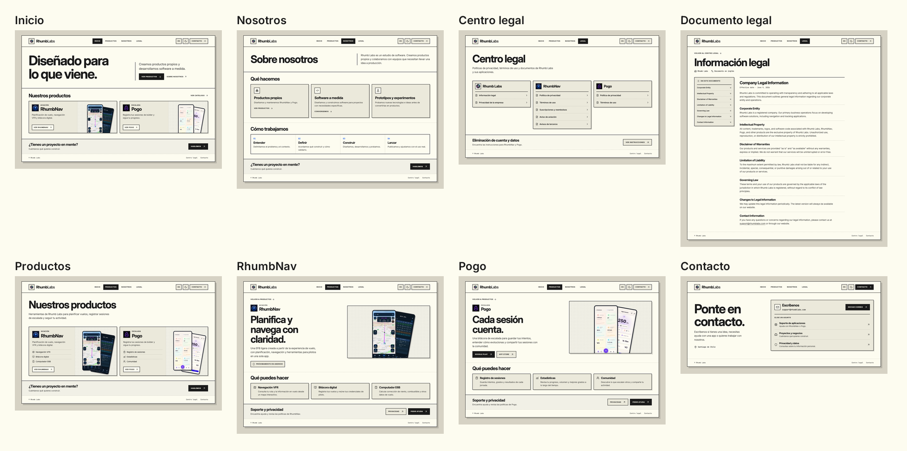
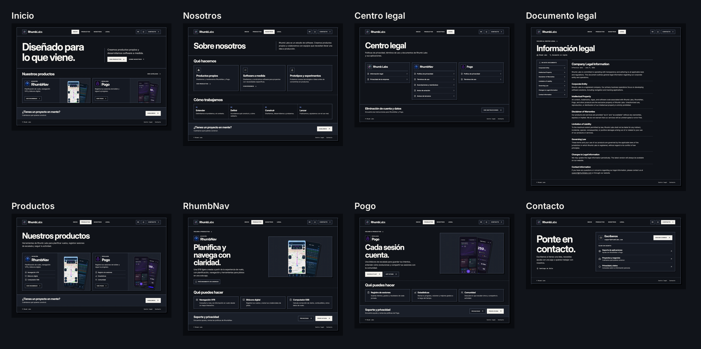

# 2000 UI · Rediseño de Rhumb Labs

Maquetas de escritorio para revisar el rediseño del sitio. Inicio da prioridad a los productos y el tema oscuro usa un fondo casi negro con un matiz azul. El catálogo y las fichas de RhumbNav y Pogo muestran capturas reales dentro de marcos de teléfono.

La [guía original del sistema visual de PaperSafe](PAPERSAFE_FLUTTER_DESIGN_SYSTEM.md) se incluye como referencia. Las rutas de código y recursos que menciona la guía corresponden al proyecto PaperSafe. Las maquetas adaptan ese sistema visual a la web de Rhumb Labs.

## Vistas generales

### Modo claro

### Modo oscuro

## Maquetas a tamaño completo

| Pantalla | Ruta | Claro | Oscuro |
| --- | --- | --- | --- |
| Inicio | `/` | [PNG](maquetas/rhumb-inicio-claro.png) | [PNG](maquetas/rhumb-inicio-oscuro.png) |
| Sobre nosotros | `/about` | [PNG](maquetas/rhumb-nosotros-claro.png) | [PNG](maquetas/rhumb-nosotros-oscuro.png) |
| Centro legal | `/legal` | [PNG](maquetas/rhumb-centro-legal-claro.png) | [PNG](maquetas/rhumb-centro-legal-oscuro.png) |
| Documento legal de Rhumb Labs | `/legal/company-legal` | [PNG](maquetas/rhumb-legal-claro.png) | [PNG](maquetas/rhumb-legal-oscuro.png) |
| Productos | `/products` | [PNG](maquetas/rhumb-productos-claro.png) | [PNG](maquetas/rhumb-productos-oscuro.png) |
| RhumbNav | `/rhumbnav` | [PNG](maquetas/rhumb-rhumbnav-claro.png) | [PNG](maquetas/rhumb-rhumbnav-oscuro.png) |
| Pogo | `/pogo` | [PNG](maquetas/rhumb-pogo-claro.png) | [PNG](maquetas/rhumb-pogo-oscuro.png) |
| Contacto | `/contact` | [PNG](maquetas/rhumb-contacto-claro.png) | [PNG](maquetas/rhumb-contacto-oscuro.png) |
